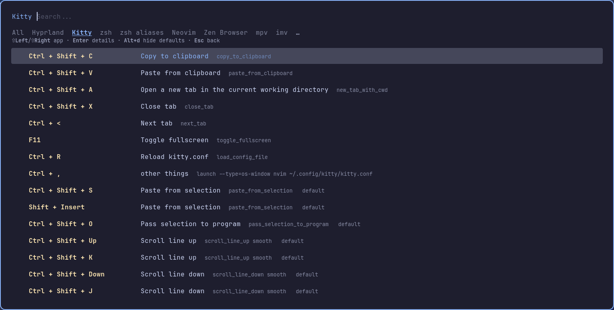

<div align="center">

# hyprmaps

*Every keymap of your Hyprland desktop, searchable in one rofi window.*




[Features](#features) · [Install](#installation) · [Usage](#usage) · [Supported apps](#supported-apps) · [Customise](#configuration) · [Document with an AI agent](#document-your-keymaps-with-an-ai-agent)

</div>

You set up dozens of shortcuts in Hyprland, kitty, zsh, tmux, Neovim and your browser, then forget half of them. **hyprmaps** reads them all from the places they already live (config files, `hyprctl`, the apps' own default lists) and shows them in rofi: pick an app, see each key and what it does, switch apps with <kbd>Shift</kbd>+<kbd>←</kbd>/<kbd>→</kbd>, type to search.

## Features

- **Finds keymaps on its own**: 41 apps known out of the box, plus the aliases of zsh, bash and fish. It knows where each one keeps its keys and how to read them, including Hyprland's Lua config, oh-my-zsh, lazy.nvim `keys = {}` specs, and the shortcuts you changed in Firefox, Zen, Brave, Vivaldi or Opera, plus your browser extensions' shortcuts.
- **Shows what each key does**: descriptions come from the config (`desc =`, `bindd`, tmux notes, the comment above a bind) or the app's own documentation. When there is none, it shows the action itself.
- **Your binds and the defaults**: your binds come first, and each app's built-in defaults follow, tagged so you can tell them apart. <kbd>Alt</kbd>+<kbd>d</kbd> hides them.
- **Asks what to include**: on start you tick the groups you care about (window manager, terminal, shell, shell aliases, editor, browser, ...). Shell shortcuts and shell aliases are separate groups and separate entries in the app list (`zsh` / `zsh aliases`), so you pick which one to see.
- **Any other app**: point it at a file and it guesses the format, or give it a regex.
- **Matches your look**: it uses your normal rofi theme, and every size, colour and font can be changed.
- **Read-only**: it never writes, moves or deletes a file of yours. See [how](#read-only-by-design).
- **Optional cache**: `cache = true` makes it open about twice as fast, and it reads an app again only when its keymaps may have changed ([how](docs/configuration.md#cache)).

## Requirements

- Hyprland (live binds come from `hyprctl`; without a running Hyprland only the config files are read)
- [rofi](https://github.com/davatorium/rofi) 1.7+ (Wayland support is built in since 2.0)
- Python 3.11 or newer. It uses only the standard library, so there is nothing to `pip install`.

### Other distributions

hyprmaps is tested only on **Arch Linux**. It should run on any Linux distribution with Hyprland, because your own binds, `hyprctl`, the browser profiles and the defaults printed by the apps themselves work the same everywhere.

The built-in defaults of a few apps come from a reference file that the distribution installs, at a fixed path. If that file is missing, the app shows only your own binds and no defaults. Nothing breaks.

| App | Defaults read from |
|-----|--------------------|
| kitty | `/usr/share/doc/kitty/kitty.conf` |
| mpv | `/usr/share/doc/mpv/input.conf` |
| imv | `/etc/imv_config` |
| foot | `/etc/xdg/foot/foot.ini` |
| fuzzel | `/etc/xdg/fuzzel/fuzzel.ini` |
| ranger | `/usr/share/doc/ranger/config/rc.conf` |

> [!WARNING]
> Untested. Expected limits on other systems:
> - **Debian / Ubuntu**: Debian packages usually compress files in `/usr/share/doc` to `.gz`, which hyprmaps does not read, so kitty and mpv likely lose their defaults. Ubuntu 22.04 ships Python 3.10, which is too old; Debian 12 and Ubuntu 24.04 have a new enough Python.
> - **NixOS**: there is no `/usr/share`, so the defaults in the table above are missing. Your own binds, including configs written by home-manager, are read normally.
> - **Fedora, openSUSE, Gentoo, Void**: should work, but some reference files may live elsewhere.
> - **FreeBSD**: not tested at all.

## Installation

```bash
git clone https://github.com/Andres-pixel35/hyprmaps ~/.local/share/hyprmaps
ln -s ~/.local/share/hyprmaps/bin/hyprmaps ~/.local/bin/hyprmaps
```

Then bind it to a key in Hyprland:

```lua
-- hyprland.lua
hl.bind("SUPER + F1", hl.dsp.exec_cmd("~/.local/bin/hyprmaps"), { description = "Show all keymaps" })
```

```ini
# hyprland.conf
bindd = SUPER, F1, Show all keymaps, exec, ~/.local/bin/hyprmaps
```

> [!TIP]
> Run `hyprmaps --list` in a terminal first. It prints every app the tool knows, whether it was found, where it reads from, and any note, all without opening rofi.

## Usage

1. **Choose what to include.** Each group lists the apps found in it. <kbd>Enter</kbd> ticks or unticks a group, and <kbd>Enter</kbd> on **▶ Show keymaps** continues. **＋ Read another file…** adds any file for this session. What you tick lasts for this run only: hyprmaps never writes a file, so it cannot remember it. To make it permanent, write it in `config.toml` ([how](docs/configuration.md#make-a-choice-permanent)).
2. **Pick an app.** Each row shows its keymap count and how many are yours. **All apps** searches everything at once.
3. **Browse its keymaps.** Type to filter. The keys are:

| Key | Action |
|-----|--------|
| <kbd>Shift</kbd>+<kbd>→</kbd> / <kbd>Ctrl</kbd>+<kbd>Tab</kbd> | Next app |
| <kbd>Shift</kbd>+<kbd>←</kbd> / <kbd>Ctrl</kbd>+<kbd>Shift</kbd>+<kbd>Tab</kbd> | Previous app |
| <kbd>Enter</kbd> | Details: full action, mode, file and line it comes from |
| <kbd>Alt</kbd>+<kbd>d</kbd> | Show / hide the apps' built-in defaults |
| <kbd>Esc</kbd> | Back (app list → groups → quit) |

Each row reads **key · description · action · [mode] · default**. A description in *italics* was generated from the action because the config gave none.

### Command line

```text
hyprmaps                  open rofi, asking what to include
hyprmaps --all            skip the question, include every app found
hyprmaps --only hyprland,kitty,nvim
hyprmaps --add kew=~/.config/kew/kewrc   also read this file (repeatable)
hyprmaps --list           print the known apps, what was found and where
hyprmaps --dump [--json]  print the keymaps (TSV or JSON) instead of opening rofi
hyprmaps --config PATH    use another config.toml
hyprmaps --descriptions PATH
```

## Supported apps

| Group | Apps |
|-------|------|
| Window manager | Hyprland (Lua and `.conf` configs) |
| Terminal | kitty, Ghostty, Alacritty, foot, WezTerm |
| Shell | zsh (incl. oh-my-zsh), bash / readline, fish |
| Terminal multiplexer | tmux, Zellij |
| Code editor | Neovim, Vim, VS Code, Code - OSS, VSCodium, Cursor, Windsurf, Helix, Zed |
| Browser | Firefox, Zen, LibreWolf, Floorp, Waterfox, Chromium, Chrome, Brave, Vivaldi, Edge, Opera, qutebrowser, and your extensions' shortcuts |
| File manager | yazi, ranger, lf, Thunar |
| Media & documents | mpv, imv, zathura |
| Launcher | rofi, fuzzel |

[docs/supported-apps.md](docs/supported-apps.md) lists, for each app, the exact files it reads, where its defaults come from, and its known limits.

## Configuration

Everything works without a config file. To change something, copy the examples and edit them:

```bash
mkdir -p ~/.config/hyprmaps
cp config.example.toml       ~/.config/hyprmaps/config.toml
cp descriptions.example.toml ~/.config/hyprmaps/descriptions.toml
```

| To... | Read |
|-------|------|
| Never read an app (e.g. tmux), skip the start question, hide defaults, change the keys inside rofi | [docs/configuration.md](docs/configuration.md) |
| **Make rofi look the way you like** (size, colours, fonts, your own `.rasi`) | [docs/appearance.md](docs/appearance.md) |
| Read an app from another path, or add an app it does not know | [docs/adding-apps.md](docs/adding-apps.md) |
| Write your own description for any key | [docs/configuration.md#descriptions](docs/configuration.md#descriptions) |

## Document your keymaps with an AI agent

Many keymaps and shell aliases have no description in their config. [docs/agent-prompt.md](docs/agent-prompt.md) contains a ready-to-paste prompt for Claude Code, Codex, OpenCode or any coding agent. It tells the agent to:
- install the tool and list your apps;
- search the web for where non-default apps keep their keymaps and add them to the config;
- write a short description for every undocumented key and shell alias into `descriptions.toml`.

Your original config files stay untouched.

## Read-only by design

- Config files are opened for reading only, with a size limit and a binary check.
- Browser defaults are read from the installed browser's own files (Firefox-family `omni.ja`, Opera's `opera.pak`, Vivaldi's `prefs_definitions.json`, qutebrowser's `configdata.yml`); profiles and extension archives are only opened for reading.
- Other defaults are printed by the apps themselves without your config: `zsh -f`, `bash --norc`, `fish --no-config`, `tmux -f /dev/null` on a private socket, `ghostty --default`, `wezterm -n`, `zellij setup --dump-config`. Those commands run with `HOME` and the XDG dirs pointing at a temporary folder, which is deleted afterwards, so no history or state reaches your home.
- A running tmux server is only *read* (`tmux -N`, never starts one). Hyprland is queried with `hyprctl binds -j`.
- Anything that would execute your config inside an app (Neovim, WezTerm) is off unless you set `live = true` for that app.
- `config.toml` and `descriptions.toml` are read, never created. You (or your agent) write them.
- The [cache](docs/configuration.md#cache) is off by default. Turned on, it writes only to `~/.cache/hyprmaps/`.

> [!NOTE]
> The only thing hyprmaps creates is the rofi window (and `~/.cache/hyprmaps/` if you turn the cache on).

## Troubleshooting

- **An app is missing**: run `hyprmaps --list`. A `·` means it was not found in `PATH` nor at its usual config path. Set the path with `[apps.<id>] paths = [...]` ([docs/adding-apps.md](docs/adding-apps.md)).
- **The list is two lines tall, or the app bar is missing**: your rofi theme sets `lines` or hides the message box. The defaults `lines = 15` and `force_layout = true` fix both. If the layout still looks wrong, set `force_layout = false` ([docs/appearance.md](docs/appearance.md)).
- **Searching `span` or `small` matches every row**: rofi filters the styled text, tags included. Avoid those words, or set `markup = false`.
- **A reader fails**: the error appears as a note under that app and the other apps keep working. `--list` shows it too.

## License

[MIT](LICENSE)
